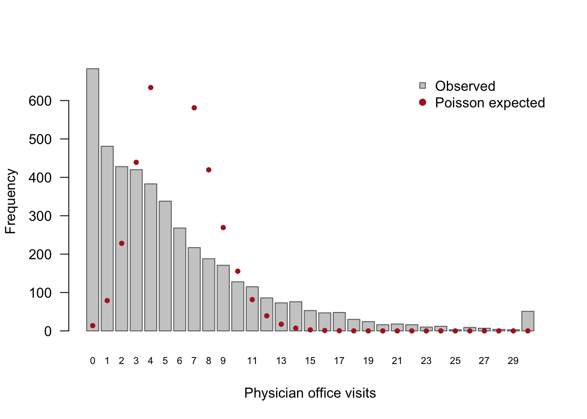

# 1 Introduction

# 1 Introduction

Counts such as the number of doctor visits are often **overdispersed**:
their variance is larger than their mean, which the Poisson model does
not allow. They often also contain **more zeros** than a Poisson (or
even a negative binomial) distribution predicts. The negative binomial
(NB2) model handles overdispersion through a dispersion parameter
$`\theta`$. The zero-inflated negative binomial (ZINB) model also allows
a separate process that produces “structural” zeros.

The **nbzinbKoo** package fits both models with algorithms written from
scratch: iteratively reweighted least squares (IRLS) alternated with
Newton–Raphson for NB regression, and an EM algorithm whose M-steps are
IRLS fits for ZINB regression. It does not call `optim()` or any other
general-purpose optimizer. This report describes the methods (Section 2)
and the package (Section 3), checks the results against `MASS::glm.nb()`
and `pscl::zeroinfl()` (Section 4), studies the ZINB estimator by
simulation (Section 5), and analyzes physician office visits in the
NMES1988 data (Section 6).

# 2 Methods

## 2.1 Negative binomial regression

For counts $`y_i`$ with covariates $`x_i`$ and offset $`o_i`$, the NB2
model has $`\log\mu_i = \eta_i = x_i^\top\beta + o_i`$ and
$`\operatorname{Var}(Y_i) = \mu_i + \mu_i^2/\theta`$. With prior weights
$`a_i`$ (all 1 in an ordinary fit) the log-likelihood is
``` math
\ell(\beta,\theta) = \sum_i a_i\Big[\log\Gamma(y_i+\theta) - \log\Gamma(\theta) - \log y_i!
  + \theta\log\theta + y_i\log\mu_i - (\theta+y_i)\log(\theta+\mu_i)\Big].
```

**IRLS for $`\beta`$ ($`\theta`$ fixed).** Fisher scoring for a log-link
GLM with variance $`V(\mu) = \mu + \mu^2/\theta`$ is weighted least
squares with
``` math
w_i = a_i\frac{(\partial\mu_i/\partial\eta_i)^2}{V(\mu_i)} = a_i\frac{\theta\mu_i}{\theta+\mu_i}, \qquad
z_i = (\eta_i - o_i) + \frac{y_i-\mu_i}{\mu_i}, \qquad
\beta^{(t+1)} = (X^\top WX)^{-1}X^\top Wz .
```
The least-squares step is solved by a QR decomposition of $`W^{1/2}X`$,
and a step that lowers $`\ell`$ is halved.

**Newton–Raphson for $`\theta`$ ($`\beta`$ fixed).** With
$`U(\theta) = \sum_i a_i[\psi(y_i+\theta) - \psi(\theta) + \log\theta + 1 - \log(\theta+\mu_i) - (y_i+\theta)/(\theta+\mu_i)]`$
and
$`H(\theta) = \sum_i a_i[\psi'(y_i+\theta) - \psi'(\theta) + 1/\theta - 2/(\theta+\mu_i) + (y_i+\theta)/(\theta+\mu_i)^2]`$,
we update $`\phi = \log\theta`$, which keeps $`\theta>0`$:
$`\phi \leftarrow \phi - U_\phi/H_\phi`$ with $`U_\phi = \theta U`$ and
$`H_\phi = \theta^2H + \theta U`$.

**Outer loop and standard errors.** We start from a Poisson IRLS fit and
the moment estimate
$`\theta^{(0)} = \sum_i a_i / \sum_i a_i(y_i/\mu_i - 1)^2`$, then
alternate the two steps until $`\ell`$ changes by less than $`10^{-8}`$.
At convergence
$`\widehat{\operatorname{Var}}(\hat\beta) = (X^\top\hat WX)^{-1}`$
(treating $`\theta`$ as known, as `glm.nb()` does) and
$`\operatorname{SE}(\hat\theta) = \{-H(\hat\theta)\}^{-1/2}`$.

## 2.2 Zero-inflated negative binomial regression

The ZINB model mixes a point mass at zero (probability $`\pi_i`$,
$`\operatorname{logit}\pi_i = z_i^\top\gamma`$) with an
NB$`(\mu_i,\theta)`$ count distribution. Its observed-data
log-likelihood is
``` math
\ell(\beta,\gamma,\theta) = \sum_{y_i=0}\log\big[\pi_i + (1-\pi_i)f_{NB}(0;\mu_i,\theta)\big]
 + \sum_{y_i>0}\big[\log(1-\pi_i) + \log f_{NB}(y_i;\mu_i,\theta)\big],
```
with $`f_{NB}(0;\mu,\theta) = \{\theta/(\theta+\mu)\}^\theta`$. Because
of the log of a sum, this is not an exponential-family likelihood and
IRLS cannot be applied to it directly. We maximize it by EM, treating
the indicator $`D_i`$ of a structural zero as missing data.

- **E-step.**
  $`\tau_i = P(D_i = 1\mid y_i) = \pi_i/\{\pi_i + (1-\pi_i)f_{NB}(0;\mu_i,\theta)\}`$
  if $`y_i = 0`$ and $`\tau_i = 0`$ otherwise.
- **M-step, zero part.** Maximize
  $`\sum_i[\tau_i\log\pi_i + (1-\tau_i)\log(1-\pi_i)]`$: a logistic
  regression with fractional response $`\tau_i`$, fitted by IRLS with
  $`w_i = \pi_i(1-\pi_i)`$ and
  $`z_i = z_i^\top\gamma + (\tau_i - \pi_i)/\{\pi_i(1-\pi_i)\}`$.
- **M-step, count part.** Maximize
  $`\sum_i(1-\tau_i)\log f_{NB}(y_i;\mu_i,\theta)`$: exactly the NB fit
  above with prior weights $`a_i = 1-\tau_i`$ (the package reuses the
  same code).

EM starts from the NB fit for $`(\beta,\theta)`$ and a logistic IRLS fit
of $`I(y_i=0)`$ on $`z_i`$ for $`\gamma`$, and stops when $`\ell`$
changes by less than $`10^{-8}`$. The package records $`\ell`$ at every
iteration and warns if it ever decreases.

**Standard errors.** We invert the observed information of $`\ell`$ in
$`(\beta,\gamma,\phi=\log\theta)`$, computed **analytically**. For
observation $`i`$ let $`h_i = \log f_{NB}(y_i;\mu_i,\theta)`$ and
$`\rho_i = 1-\tau_i`$. Then
``` math
\frac{\partial\ell_i}{\partial\eta_{z}} = \tau_i - \pi_i,\quad
\frac{\partial\ell_i}{\partial a} = \rho_i h_a,\quad
\frac{\partial^2\ell_i}{\partial\eta_z^2} = \tau_i(1-\tau_i) - \pi_i(1-\pi_i),\quad
\frac{\partial^2\ell_i}{\partial\eta_z\,\partial a} = -\tau_i\rho_i h_a,\quad
\frac{\partial^2\ell_i}{\partial a\,\partial b} = \rho_i h_{ab} + \tau_i\rho_i h_a h_b,
```
for $`a,b\in\{\eta_c,\phi\}`$, where
$`h_{\eta} = \theta(y-\mu)/(\theta+\mu)`$,
$`h_{\eta\eta} = -\theta\mu(\theta+y)/(\theta+\mu)^2`$,
$`h_\phi = \theta U_i`$, $`h_{\phi\phi} = \theta^2H_i + \theta U_i`$ and
$`h_{\eta\phi} = \theta\mu(y-\mu)/(\theta+\mu)^2`$. The chain rule
($`\partial\eta_c/\partial\beta = x_i`$,
$`\partial\eta_z/\partial\gamma = z_i`$) gives the blocks of the
Hessian. The test suite checks this Hessian against
`numDeriv::hessian()` of the package’s own log-likelihood.

# 3 The R package

The package is installed with
`devtools::install_github("gracko95/nbzinbKoo")`. Its main functions
are:

| Function | Purpose |
|----|----|
| `nbreg(formula, data, offset, control)` | NB2 regression (IRLS + Newton–Raphson) |
| `zinbreg(formula, data, offset, control)` | ZINB regression (EM with IRLS M-steps); formula `y ~ x | z` |
| `nbreg_control()`, `zinbreg_control()` | tolerances, maximum iterations, `trace`, Hessian type |

Both functions return S3 objects (classes `"nbreg"` and `"zinbreg"`)
with methods `print`, `summary`, `coef`, `vcov`, `logLik` (so `AIC()`
and `BIC()` work), `fitted`, `residuals` (response and Pearson), `nobs`
and `predict` (with `newdata`; for `zinbreg`, `type = "response"`,
`"count"`, `"zero"` or `"prob0"`). The code is organized as `R/nbreg.R`
(NB engine), `R/zinbreg.R` (EM engine and analytic Hessian),
`R/methods.R` and `R/utils.R` (log-likelihood, $`\theta`$ derivatives,
weighted least squares).

``` r
fit <- zinbreg(art ~ fem + kid5 + ment | ment, data = bioChemists)
round(coef(fit), 3)
```

    count_(Intercept)    count_femWomen        count_kid5        count_ment 
                0.494            -0.228            -0.131             0.024 
     zero_(Intercept)         zero_ment 
               -0.795            -0.619 

``` r
c(theta = fit$theta, logLik = fit$loglik, EM_iterations = fit$iter)
```

            theta        logLik EM_iterations 
         2.695777  -1554.752519    113.000000 

# 4 Benchmarking

We compare `nbreg()` with `MASS::glm.nb()` and `zinbreg()` with
`pscl::zeroinfl(dist = "negbin")` on `bioChemists` (Long, 1997) and
`NMES1988` (Deb and Trivedi, 1997). The reference functions were run
with tight tolerances (`epsilon = 1e-10` and `reltol = 1e-12`).
[Table 1](#tbl-agree) gives the maximum absolute differences, which are
all far below the required $`10^{-5}`$ (NB coefficients and SEs),
$`10^{-4}`$ (NB $`\theta`$ and log-likelihood) and $`10^{-3}`$ (ZINB). A
positive log-likelihood difference means that our fit attains a slightly
higher maximum.

| Fit               |    Coef |      SE |   theta |   logLik | Iter | Time (ours) | Time (ref.) |
|:------------------|--------:|--------:|--------:|---------:|-----:|------------:|------------:|
| NB, bioChemists   | 2.1e-08 | 9.8e-10 | 6.7e-08 |  4.5e-13 |    4 |       0.016 |       0.018 |
| NB, NMES1988      | 4.7e-08 | 9.2e-10 | 4.3e-08 |  7.1e-11 |    3 |       0.076 |       0.064 |
| ZINB, bioChemists | 1.5e-04 | 9.4e-05 | 1.3e-05 | -4.2e-08 |  111 |       1.065 |       0.041 |
| ZINB, NMES1988    | 2.6e-05 | 1.7e-05 | 4.4e-06 | -1.6e-08 |   53 |       3.034 |       0.197 |

Table 1: Maximum absolute differences from the reference
implementations, iterations of our algorithm (outer NB iterations or EM
iterations), and median elapsed time in seconds. For ZINB the theta row
is log(theta).

| Term                  |  zinbreg | zeroinfl | SE zinbreg | SE zeroinfl |
|:----------------------|---------:|---------:|-----------:|------------:|
| count\_(Intercept)    |  1.19372 |  1.19371 |    0.05666 |     0.05666 |
| count_hospital        |  0.20148 |  0.20148 |    0.02036 |     0.02036 |
| count_healthpoor      |  0.28513 |  0.28513 |    0.04509 |     0.04509 |
| count_healthexcellent | -0.31934 | -0.31934 |    0.06040 |     0.06040 |
| count_chronic         |  0.12900 |  0.12900 |    0.01193 |     0.01193 |
| count_gendermale      | -0.08028 | -0.08028 |    0.03102 |     0.03102 |
| count_school          |  0.02142 |  0.02142 |    0.00436 |     0.00436 |
| count_insuranceyes    |  0.12586 |  0.12586 |    0.04159 |     0.04159 |
| zero\_(Intercept)     | -0.04689 | -0.04688 |    0.26856 |     0.26856 |
| zero_hospital         | -0.80046 | -0.80048 |    0.42080 |     0.42082 |
| zero_chronic          | -1.24791 | -1.24794 |    0.17831 |     0.17832 |
| zero_gendermale       |  0.64768 |  0.64768 |    0.20011 |     0.20011 |
| zero_school           | -0.08377 | -0.08377 |    0.02625 |     0.02625 |
| zero_insuranceyes     | -1.17561 | -1.17562 |    0.22012 |     0.22012 |
| log(theta)            |  0.39415 |  0.39414 |    0.03504 |     0.03504 |

Table 2: ZINB estimates and standard errors for NMES1988: zinbreg()
versus zeroinfl().

The side-by-side tables for the other three fits are produced by
`inst/benchmark/benchmark.R` and look the same. EM needs more iterations
than BFGS and is slower (each M-step is itself an iterative fit), but
every run converged and the log-likelihood never decreased.

# 5 Simulation study

We simulated $`R = 200`$ data sets of size $`n = 500`$ (seed 651) from a
ZINB model with $`\log\mu_i = 1 + 0.5x_{1i}  -0.7x_{2i}`$
($`x_1\sim N(0,1)`$, $`x_2\sim\text{Bernoulli}(0.5)`$),
$`\operatorname{logit}\pi_i = -1 + 0.8z_{1i}`$ ($`z_1\sim N(0,1)`$) and
$`\theta = 1.5`$, and fitted each with `zinbreg()` (script
`inst/benchmark/simulation.R`). 200 of 200 fits converged.

| Parameter          |   True | Mean est. |   Bias | Mean SE | MC SD | Coverage |
|:-------------------|-------:|----------:|-------:|--------:|------:|---------:|
| count\_(Intercept) |  1.000 |     0.997 | -0.003 |   0.099 | 0.101 |    0.930 |
| count_x1           |  0.500 |     0.502 |  0.002 |   0.064 | 0.064 |    0.960 |
| count_x2           | -0.700 |    -0.709 | -0.009 |   0.126 | 0.131 |    0.945 |
| zero\_(Intercept)  | -1.000 |    -1.053 | -0.053 |   0.329 | 0.335 |    0.960 |
| zero_z1            |  0.800 |     0.840 |  0.040 |   0.235 | 0.246 |    0.955 |
| log(theta)         |  0.405 |     0.444 |  0.039 |   0.252 | 0.248 |    0.965 |

Table 3: Simulation results: bias, mean estimated SE versus Monte Carlo
SD of the estimates, and coverage of 95% Wald intervals.

TODO (your words): comment on the bias (is it small relative to the
SE?), whether the mean SE matches the Monte Carlo SD (are the analytic
SEs right?), and whether coverage is close to 0.95 given the Monte Carlo
error $`\sqrt{0.95 \cdot 0.05 / R} \approx 0.015`$.

# 6 Data analysis: physician office visits (NMES1988)

The NMES1988 data record the number of physician office visits
(`visits`) for 4406 people aged 66 and over. The mean is 5.77 but the
variance is 45.7, about 8 times larger, which is strong evidence of
overdispersion. 15.5% of the people made no visits, while a Poisson
distribution with the same mean predicts only 0.31%
([Figure 1](#fig-visits)).



Figure 1: Observed distribution of visits (bars, 30 = 30 or more) and
frequencies expected under a Poisson distribution with the same mean
(points).

``` r
f_count <- visits ~ hospital + health + chronic + gender + school + insurance
m_pois <- glm(f_count, family = poisson, data = NMES1988)      # reference only
m_nb   <- nbreg(f_count, data = NMES1988)
m_zinb <- zinbreg(visits ~ hospital + health + chronic + gender + school + insurance |
                    hospital + chronic + gender + school + insurance, data = NMES1988)
```

| Model   |  df |   logLik |     AIC |     BIC | Expected zeros |
|:--------|----:|---------:|--------:|--------:|---------------:|
| Poisson |   8 | -17971.6 | 35959.2 | 36010.4 |           46.7 |
| NB      |   9 | -12170.6 | 24359.1 | 24416.6 |          608.0 |
| ZINB    |  15 | -12090.7 | 24211.4 | 24307.3 |          708.9 |

Table 4: Model comparison for NMES1988, including the expected number of
zeros under each model.

The data contain 683 zeros.

| Covariate       |  NB IRR (95% CI)  | ZINB count IRR (95% CI) |
|:----------------|:-----------------:|:-----------------------:|
| hospital        | 1.24 (1.20, 1.29) |    1.22 (1.18, 1.27)    |
| healthpoor      | 1.36 (1.23, 1.49) |    1.33 (1.22, 1.45)    |
| healthexcellent | 0.71 (0.63, 0.80) |    0.73 (0.65, 0.82)    |
| chronic         | 1.19 (1.16, 1.22) |    1.14 (1.11, 1.16)    |
| gendermale      | 0.88 (0.83, 0.94) |    0.92 (0.87, 0.98)    |
| school          | 1.03 (1.02, 1.04) |    1.02 (1.01, 1.03)    |
| insuranceyes    | 1.25 (1.16, 1.35) |    1.13 (1.05, 1.23)    |

Table 5: Count part: incidence rate ratios (IRR) with 95% Wald
confidence intervals.

| Covariate    |    OR (95% CI)    | p-value |
|:-------------|:-----------------:|:-------:|
| hospital     | 0.45 (0.20, 1.02) | 0.0571  |
| chronic      | 0.29 (0.20, 0.41) | \<1e-04 |
| gendermale   | 1.91 (1.29, 2.83) | 0.0012  |
| school       | 0.92 (0.87, 0.97) | 0.0014  |
| insuranceyes | 0.31 (0.20, 0.48) | \<1e-04 |

Table 6: ZINB zero part: odds ratios (OR) of being a structural zero (a
person who would not visit a physician), with 95% Wald confidence
intervals.

The NB model estimates $`\hat\theta = 1.21`$ (SE 0.034), and the ZINB
model $`\hat\theta = 1.48`$.

TODO (your words; this is graded on interpretation, do not copy Appendix
A):

1.  What the descriptive summary and [Table 4](#tbl-compare) say about
    overdispersion and excess zeros (compare the expected zeros of the
    NB model with the 683 observed).
2.  Interpret the main IRRs in plain language (e.g. “each additional
    chronic condition multiplies the expected number of visits by …”).
3.  Interpret the zero-part ORs: which covariates change the odds of
    being a person who would never visit a physician, and in which
    direction?
4.  Which model you prefer (AIC vs BIC, expected zeros,
    interpretability) and why.

# 7 Discussion

TODO (your words): limitations and extensions. Ideas to consider: EM is
slower than BFGS ([Table 1](#tbl-agree)) and could be accelerated
(e.g. a final few Newton steps on the full likelihood, or SQUAREM); the
NB standard errors treat $`\theta`$ as known, as `glm.nb()` does; only
the count part accepts an offset; other links for the zero part,
zero-inflated Poisson or hurdle models, and robust (sandwich) standard
errors are natural extensions.

# 8 AI-use statement

TODO (your words): describe how you used Claude Code (what you asked it
to do), what you verified yourself (e.g. comparing the IRLS weights,
$`\tau_i`$ and the $`\theta`$ score with Section 3, running the tests,
the prohibited-function grep), and one concrete example of output you
corrected or rejected.

# 9 References

- Cameron, A. C. and Trivedi, P. K. (2013). *Regression Analysis of
  Count Data* (2nd ed.). Cambridge University Press.
- Deb, P. and Trivedi, P. K. (1997). Demand for medical care by the
  elderly: A finite mixture approach. *Journal of Applied Econometrics*,
  12(3), 313–336.
- Dempster, A. P., Laird, N. M. and Rubin, D. B. (1977). Maximum
  likelihood from incomplete data via the EM algorithm. *JRSS-B*, 39(1),
  1–38.
- Lambert, D. (1992). Zero-inflated Poisson regression, with an
  application to defects in manufacturing. *Technometrics*, 34(1), 1–14.
- Long, J. S. (1997). *Regression Models for Categorical and Limited
  Dependent Variables*. Sage.
- McCullagh, P. and Nelder, J. A. (1989). *Generalized Linear Models*
  (2nd ed.). Chapman & Hall.
- Venables, W. N. and Ripley, B. D. (2002). *Modern Applied Statistics
  with S* (4th ed.). Springer.
- Wickham, H. and Bryan, J. (2023). *R Packages* (2nd ed.). O’Reilly.
- Zeileis, A., Kleiber, C. and Jackman, S. (2008). Regression models for
  count data in R. *Journal of Statistical Software*, 27(8), 1–25.
